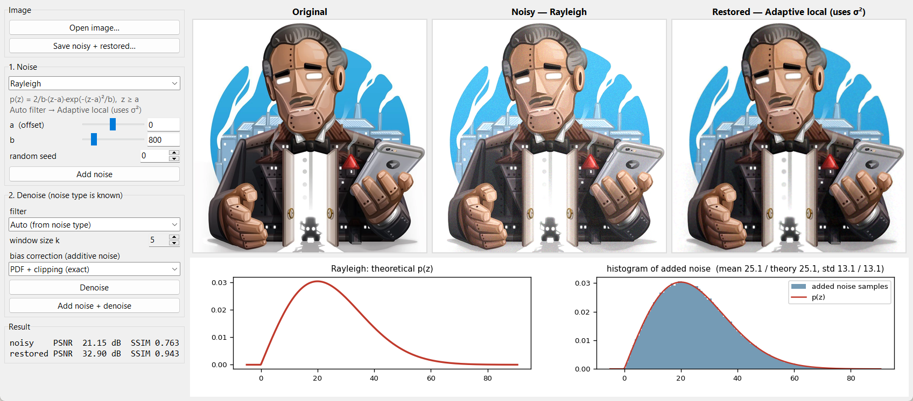
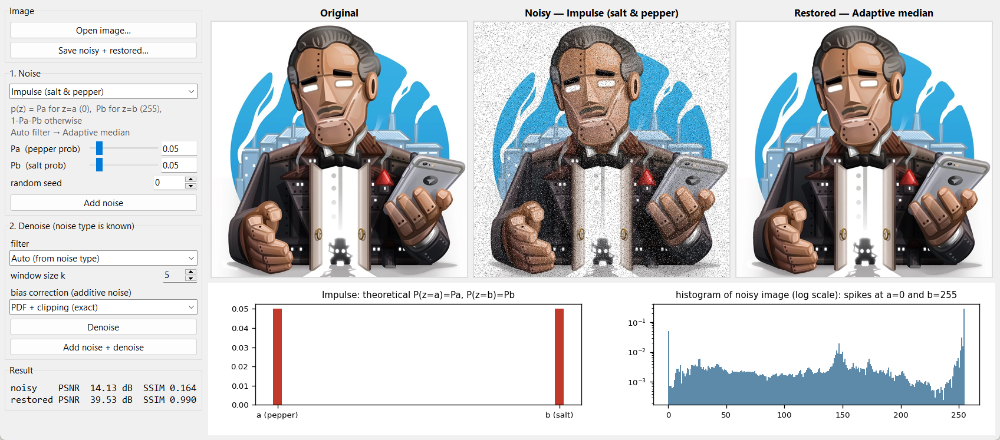

# بینایی کامپیوتر، تمرین ۱: مدل‌های نویز و حذف نویز با دانستن نوع نویز

**شماره‌ی دانشجویی:** `40130112106`

> کد کامل در پوشه‌ی [`src`](src/) است و تصویر ورودی در [`images/input.png`](images/input.png).
> همه‌ی تصویرها و جدول‌های این پاسخ را اسکریپت `make_results.py` با بذر تصادفی ثابت (`seed = 0`) ساخته است و با اجرای دوباره همین عددها به دست می‌آید.
>
> در این متن «نویز جمع‌شونده» یعنی نویزی که مستقل از تصویر با مقدار پیکسل جمع می‌شود: $g(x,y) = f(x,y) + \eta(x,y)$.

--------

=سوال=

به یک تصویر ۶ نویز اعمال کنید و با دانستن نوع نویز، آن را دی‌نویز کنید. تمرین باید به صورت یک کد با رابط گرافیکی (GUI) ارائه شود.

شش نویز اسلاید: گاوسی (Gaussian)، رایلی (Rayleigh)، گاما یا ارلانگ (Gamma)، نمایی (Exponential)، یکنواخت (Uniform) و ضربه‌ای (Impulse).

=پاسخ=

### ۱. اجرای برنامه

برنامه با پایتون نوشته شده و رابط گرافیکی آن با کتابخانه‌ی Tkinter ساخته شده است که همراه خود پایتون نصب می‌شود. وابستگی‌های دیگر در [`requirements.txt`](src/requirements.txt) آمده است:

```bash
cd Computer-vision/hw1_40130112106/src
pip install -r requirements.txt
python noise_gui.py
```

برنامه با تصویر همین تمرین باز می‌شود و با دکمه‌ی `Open image…` هر تصویر دیگری را هم می‌پذیرد. کد در چهار فایل تقسیم شده است:

| فایل | کار |
| --- | --- |
| [`noise_models.py`](src/noise_models.py) | شش مدل نویز: تولید نمونه، تابع چگالی $p(z)$، میانگین و واریانس، و جدول اثر بریده‌شدن (clipping) |
| [`denoise_filters.py`](src/denoise_filters.py) | فیلترهای ترمیم فصل ۵ کتاب گونزالس، انتخاب خودکار فیلتر بر اساس نوع نویز، و معیارهای PSNR و SSIM |
| [`noise_gui.py`](src/noise_gui.py) | رابط گرافیکی |
| [`make_results.py`](src/make_results.py) | اجرای دسته‌ای روی هر شش نویز و ساخت تصویرها و جدول‌های پوشه‌ی [`results`](results/) |

کار با برنامه دو مرحله دارد. در بخش `1. Noise` نوع نویز و پارامترهای آن (همان $\mu$، $\sigma$، $a$، $b$، $P_a$ و $P_b$ اسلاید) انتخاب و با دکمه‌ی `Add noise` به تصویر اضافه می‌شود. زیر تصویرها دو نمودار هست: سمت چپ تابع چگالی نظری $p(z)$ و سمت راست هیستوگرام نویزی که واقعاً به تصویر اضافه شده، همراه با میانگین و انحراف معیار اندازه‌گیری‌شده و نظری. این نمودار نشان می‌دهد نمونه‌برداری درست انجام شده است. در بخش `2. Denoise` برنامه همان نویزی را که اضافه کرده می‌شناسد و گزینه‌ی `Auto` بر اساس آن فیلتر و پارامترهایش را انتخاب می‌کند. می‌توان فیلتر، اندازه‌ی پنجره و روش حذف بایاس را دستی هم عوض کرد و نتیجه را در کادر `Result` با PSNR و SSIM مقایسه کرد.





### ۲. شش مدل نویز و روش تولید آن‌ها

همه‌ی مقدارها در مقیاس شدت ۸ بیتی (۰ تا ۲۵۵) هستند. نویز جمع‌شونده برای هر کانال رنگ جداگانه تولید می‌شود، با تصویر جمع می‌شود، به بازه‌ی $[0, 255]$ بریده و گرد می‌شود؛ یعنی همان چیزی که در یک فایل ۸ بیتی ذخیره می‌شود.

**گاوسی.** با `rng.normal` تولید می‌شود.

$$p(z) = \frac{1}{\sqrt{2\pi}\,\sigma} e^{-(z-\mu)^2 / 2\sigma^2}$$

**رایلی.** تابع توزیع تجمعی آن $F(z) = 1 - e^{-(z-a)^2/b}$ است و وارون آن بسته است، پس با روش تبدیل وارون از عدد یکنواخت $U$ ساخته می‌شود: $z = a + \sqrt{-b \ln(1-U)}$. میانگین $a + \sqrt{\pi b/4}$ و واریانس $b(4-\pi)/4$ است.

$$p(z) = \frac{2}{b}(z-a)\, e^{-(z-a)^2/b}, \quad z \ge a$$

**گاما (ارلانگ).** متغیر ارلانگ با پارامتر صحیح $b$ جمع $b$ متغیر نمایی مستقل با نرخ $a$ است و با `rng.gamma(b, 1/a)` تولید می‌شود. میانگین $b/a$ و واریانس $b/a^2$ است.

$$p(z) = \frac{a^b z^{b-1}}{(b-1)!} e^{-az}, \quad z \ge 0$$

**نمایی.** حالت خاص ارلانگ با $b = 1$ است. میانگین $1/a$ و واریانس $1/a^2$ است.

$$p(z) = a e^{-az}, \quad z \ge 0$$

**یکنواخت.** میانگین $(a+b)/2$ و واریانس $(b-a)^2/12$ است.

$$p(z) = \frac{1}{b-a}, \quad a \le z \le b$$

**ضربه‌ای (نمک و فلفل).** این نویز جمع‌شونده نیست و مقدار پیکسل را جایگزین می‌کند. برای هر پیکسل یک عدد یکنواخت $U$ گرفته می‌شود: اگر $U < P_a$ پیکسل سیاه (۰، فلفل) و اگر $P_a \le U < P_a + P_b$ سفید (۲۵۵، نمک) می‌شود. این تصمیم برای هر سه کانال یکی است تا نقطه‌ها واقعاً سیاه و سفید باشند، نه رنگی.

پارامترهای پیش‌فرض برنامه طوری انتخاب شده‌اند که نویز به چشم دیده شود:

| نویز | پارامتر پیش‌فرض | میانگین نویز | انحراف معیار نویز |
| --- | --- | --- | --- |
| گاوسی | μ = ۰، σ = ۲۵ | ۰ | ۲۵ |
| رایلی | a = ۰، b = ۸۰۰ | ۲۵٫۰۷ | ۱۳٫۱۰ |
| گاما (ارلانگ) | a = ۰٫۲، b = ۴ | ۲۰ | ۱۰ |
| نمایی | a = ۰٫۰۶ | ۱۶٫۶۷ | ۱۶٫۶۷ |
| یکنواخت | a = ۰، b = ۶۰ | ۳۰ | ۱۷٫۳۲ |
| ضربه‌ای | Pa = ۰٫۰۵، Pb = ۰٫۰۵ | ــ | ــ |

### ۳. دانستن نوع نویز چه کمکی به حذف آن می‌کند؟

اگر نوع نویز و پارامترهایش را بدانیم، سه تصمیم دیگر حدسی نیست.

**انتخاب نوع فیلتر.** نویز ضربه‌ای فقط بخشی از پیکسل‌ها را خراب می‌کند و مقدار آن‌ها را به دو سر بازه می‌برد. فیلترهای میانگین‌گیر این مقدارهای پرت را در همسایه‌ها پخش می‌کنند، ولی فیلترهای آماره‌ی ترتیبی (میانه) آن‌ها را کنار می‌گذارند. برای این نویز فیلتر میانه‌ی تطبیقی گونزالس به کار رفته است: پنجره از ۳×۳ شروع می‌شود و تا وقتی میانه‌ی پنجره خودش ضربه باشد (سطح A)، بزرگ‌تر می‌شود (حداکثر ۷×۷). بعد اگر خود پیکسل ضربه نباشد (سطح B) دست‌نخورده می‌ماند و فقط پیکسل‌های خراب با میانه جایگزین می‌شوند. به همین دلیل لبه‌ها تقریباً سالم می‌مانند. پنج نویز دیگر پیوسته و جمع‌شونده‌اند و روی همه‌ی پیکسل‌ها اثر می‌گذارند، پس ابزار مناسب برای آن‌ها میانگین‌گیری است.

**تنظیم پارامتر فیلتر.** برای نویز جمع‌شونده فیلتر کاهش نویز محلی تطبیقی (adaptive local noise reduction) به کار رفته است:

$$\hat f(x,y) = g(x,y) - \frac{\sigma_\eta^2}{\sigma_L^2}\,\big[g(x,y) - m_L\big]$$

در این رابطه $m_L$ و $\sigma_L^2$ میانگین و واریانس محلی در پنجره‌ی ۵×۵ هستند و نسبت $\sigma_\eta^2/\sigma_L^2$ حداکثر ۱ گرفته می‌شود. در ناحیه‌ی صاف $\sigma_L^2 \approx \sigma_\eta^2$ است و خروجی همان میانگین محلی می‌شود؛ روی لبه $\sigma_L^2 \gg \sigma_\eta^2$ است و پیکسل تقریباً دست‌نخورده می‌ماند. این فیلتر بدون دانستن واریانس نویز $\sigma_\eta^2$ قابل استفاده نیست و این واریانس مستقیماً از پارامترهای مدل به دست می‌آید (جدول بخش ۲).

**حذف بایاس.** چهار نویز رایلی، گاما، نمایی و یکنواخت (با $a = 0$) میانگین مثبت دارند، پس تصویر نویزی روشن‌تر از تصویر اصلی است و هیچ فیلتر میانگین‌گیری این روشن‌شدن را برنمی‌گرداند. راه ساده کم‌کردن میانگین نویز از خروجی است، ولی روی این تصویر خوب کار نمی‌کند: حدود ۳۲٪ پیکسل‌های تصویر پس‌زمینه‌ی سفید (نزدیک ۲۵۵) هستند. در این پیکسل‌ها $f + \eta$ از ۲۵۵ بیشتر می‌شود و بریده می‌شود، پس نویزی در آن‌ها باقی نمی‌ماند. کم‌کردن ۲۵ واحد میانگین رایلی پس‌زمینه را خاکستری می‌کند. همین اثر برای نویز گاوسی با میانگین صفر هم وجود دارد، چون نیمه‌ی منفی نویز در پس‌زمینه‌ی سفید می‌ماند و نیمه‌ی مثبت بریده می‌شود.

چون تابع چگالی نویز معلوم است، می‌توان این اثر را دقیق حساب کرد. برای هر مقدار واقعی $f$ میانگین و واریانس مشاهده‌ی بریده‌شده محاسبه می‌شود:

$$h(f) = E\big[\mathrm{clip}(f + \eta,\ 0,\ 255)\big], \qquad v(f) = \mathrm{Var}\big[\mathrm{clip}(f + \eta,\ 0,\ 255)\big]$$

برای محاسبه، ۴۰۰۰ چندک نویز از وارون تابع توزیع ($F^{-1}$) گرفته می‌شود؛ پس نتیجه قطعی است و به نمونه‌ی تصادفی بستگی ندارد. تابع $h$ صعودی است و می‌توان آن را وارون کرد. خروجی فیلتر میانگین‌گیر تخمینی از $h(f)$ است، پس با گذراندن آن از $h^{-1}$ هم میانگین نویز و هم بایاس بریده‌شدن یک‌جا حذف می‌شود. جدول $v(f)$ هم به‌جای $\sigma_\eta^2$ ثابت در فیلتر تطبیقی به کار می‌رود، چون پیکسل نزدیک ۲۵۵ واقعاً نویز کمتری دارد. این کار در تابع `clip_tables` در فایل `noise_models.py` انجام می‌شود.

### ۴. نتایج

جدول زیر خروجی گزینه‌ی `Auto` را نشان می‌دهد؛ یعنی فیلتر تطبیقی محلی همراه با حذف بایاس دقیق برای پنج نویز جمع‌شونده و فیلتر میانه‌ی تطبیقی برای نویز ضربه‌ای:

| نویز | فیلتر | PSNR نویزی (dB) | SSIM نویزی | PSNR ترمیم‌شده (dB) | SSIM ترمیم‌شده |
| --- | --- | --- | --- | --- | --- |
| گاوسی | تطبیقی محلی | ۲۱٫۳۱ | ۰٫۴۴۱ | ۲۹٫۲۱ | ۰٫۸۶۵ |
| رایلی | تطبیقی محلی | ۲۱٫۱۵ | ۰٫۷۶۳ | ۳۲٫۹۰ | ۰٫۹۴۳ |
| گاما (ارلانگ) | تطبیقی محلی | ۲۳٫۱۲ | ۰٫۸۲۶ | ۳۴٫۳۵ | ۰٫۹۵۸ |
| نمایی | تطبیقی محلی | ۲۲٫۸۸ | ۰٫۷۳۰ | ۳۱٫۴۸ | ۰٫۹۱۷ |
| یکنواخت | تطبیقی محلی | ۱۹٫۴۷ | ۰٫۶۹۴ | ۳۱٫۶۵ | ۰٫۹۳۲ |
| ضربه‌ای | میانه‌ی تطبیقی | ۱۴٫۱۳ | ۰٫۱۶۴ | ۳۹٫۵۳ | ۰٫۹۹۰ |

در هر تصویر زیر بخشی از چهره با بزرگ‌نمایی ۲ برابر آمده است؛ از چپ به راست: تصویر اصلی، تصویر نویزی، تصویر ترمیم‌شده. تصویرهای کامل با نام‌های `noisy_*.png` و `restored_*.png` در پوشه‌ی [`results`](results/) هستند.

**گاوسی**


**رایلی**


**گاما (ارلانگ)**


**نمایی**


**یکنواخت**


**ضربه‌ای**


برای اینکه نشان داده شود انتخاب فیلتر واقعاً به نوع نویز بستگی دارد، هر هشت فیلتر روی هر شش نویز اجرا شد. عددها PSNR بر حسب دسی‌بل هستند و بهترین هر سطر پررنگ شده است. اندازه‌ی پنجره برای میانگین هندسی، کنتراهارمونیک و میانه ۳×۳ و برای بقیه ۵×۵ است:

| نویز | میانگین حسابی | میانگین هندسی | کنتراهارمونیک | میانه | میانگین پیراسته (α-trimmed) | تطبیقی محلی | میانه‌ی تطبیقی | میانگین‌گیری غیرمحلی (NLM) |
| --- | --- | --- | --- | --- | --- | --- | --- | --- |
| گاوسی | ۲۷٫۹۵ | ۲۶٫۲۹ | ۲۳٫۷۴ | ۲۷٫۸۸ | ۲۸٫۸۵ | **۲۹٫۲۱** | ۲۴٫۲۵ | ۲۷٫۸۵ |
| رایلی | ۲۸٫۳۳ | ۲۴٫۰۶ | ۲۳٫۴۵ | ۲۴٫۶۴ | ۲۹٫۶۴ | **۳۲٫۹۰** | ۲۴٫۱۳ | ۲۸٫۳۶ |
| گاما (ارلانگ) | ۲۸٫۵۵ | ۲۵٫۷۸ | ۲۴٫۹۲ | ۲۷٫۰۹ | ۲۹٫۹۷ | **۳۴٫۳۵** | ۲۶٫۶۲ | ۲۹٫۴۴ |
| نمایی | ۲۸٫۵۵ | ۲۶٫۵۰ | ۲۴٫۵۳ | ۲۸٫۹۸ | ۲۹٫۷۰ | **۳۱٫۴۸** | ۲۷٫۲۵ | ۳۰٫۸۵ |
| یکنواخت | ۲۸٫۱۰ | ۲۲٫۵۱ | ۲۲٫۰۸ | ۲۲٫۴۹ | ۲۹٫۱۸ | **۳۱٫۶۵** | ۲۱٫۸۶ | ۲۸٫۴۷ |
| ضربه‌ای | ۲۳٫۷۳ | ۱۲٫۸۳ | ۱۳٫۷۵ | ۳۵٫۰۵ | ۲۹٫۳۱ | ۱۴٫۱۳ | **۳۹٫۵۳** | ۱۴٫۳۳ |

اثر روش حذف بایاس در فیلتر تطبیقی محلی (PSNR بر حسب دسی‌بل):

| نویز | جدول دقیق از روی PDF و بریده‌شدن | فقط کم‌کردن میانگین نویز | بدون اصلاح |
| --- | --- | --- | --- |
| گاوسی | ۲۹٫۲۱ | ۲۷٫۹۶ | ۲۷٫۹۶ |
| رایلی | ۳۲٫۹۰ | ۲۴٫۳۱ | ۲۱٫۸۳ |
| گاما (ارلانگ) | ۳۴٫۳۵ | ۲۶٫۲۷ | ۲۳٫۷۰ |
| نمایی | ۳۱٫۴۸ | ۲۶٫۶۲ | ۲۴٫۷۲ |
| یکنواخت | ۳۱٫۶۵ | ۲۲٫۶۸ | ۲۰٫۳۷ |

### ۵. نتیجه‌گیری

در هر شش حالت، فیلتری که از روی نوع نویز انتخاب شد بهترین نتیجه را داد و ضعیف‌ترین عددهای جدول مقایسه درست همان‌جایی است که فیلتر با نویز جور نیست. فیلتر میانه‌ی تطبیقی روی نویز ضربه‌ای به ۳۹٫۵ دسی‌بل رسید، ولی روی نویز گاوسی از میانگین حسابی ساده هم بدتر بود. برعکس، فیلتر تطبیقی محلی روی نویز ضربه‌ای عملاً هیچ کاری نکرد (۱۴٫۱ دسی‌بل، برابر تصویر نویزی)، چون نقطه‌های نمک و فلفل واریانس محلی را بالا می‌برند و فیلتر آن‌ها را لبه حساب می‌کند. میانگین هندسی و کنتراهارمونیک هم روی نویز ضربه‌ای دوطرفه شکست خوردند؛ این دو فیلتر برای وقتی ساخته شده‌اند که فقط نمک یا فقط فلفل وجود داشته باشد.

بیشترین سود دانستن مدل نویز از حذف بایاس آمد. در چهار نویز با میانگین مثبت، فیلتر بدون اصلاح کمتر از ۲ دسی‌بل بهتر از تصویر نویزی بود، چون روشن‌شدن تصویر سر جایش می‌ماند. کم‌کردن میانگین نویز حدود ۲ تا ۳ دسی‌بل دیگر اضافه کرد، ولی پس‌زمینه‌ی سفید را خاکستری کرد. جدول دقیقی که از روی تابع چگالی و اثر بریده‌شدن ساخته شد ۵ تا ۹ دسی‌بل دیگر روی آن گذاشت. به عبارت دیگر، در این تصویر دانستن شکل کامل توزیع نویز، و نه فقط میانگین و واریانس آن، تفاوت اصلی را ایجاد کرد.

یک محدودیت هم باید گفته شود: در این برنامه پارامترهای نویز دقیقاً معلوم‌اند، چون خود برنامه نویز را اضافه کرده است. در عمل این پارامترها باید از یک ناحیه‌ی صاف تصویر تخمین زده شوند (روشی که گونزالس با هیستوگرام یک تکه‌ی یکنواخت نشان می‌دهد) و خطای این تخمین مستقیماً به $\sigma_\eta^2$ و جدول $h$ منتقل می‌شود.

--------
